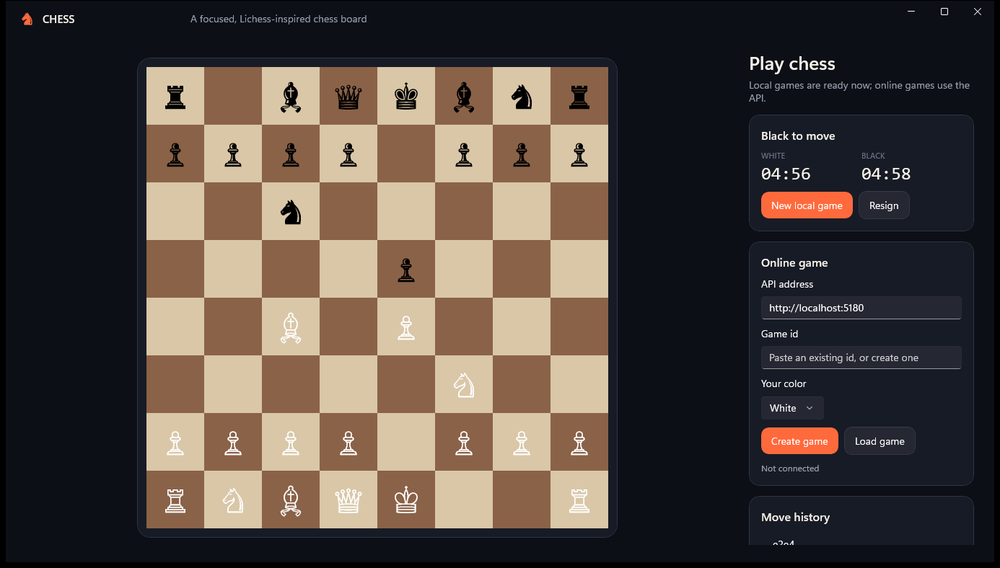

# Chess

A Windows-first chess application built around a **shared C# rules engine**: a WinUI 3 desktop client for local play, and an ASP.NET Core REST + SignalR API for server-authoritative online games.



## What's in this first slice

- **Complete move legality** in `Chess.Domain`: castling (with rook movement), en passant, promotion, check, checkmate, stalemate, insufficient-material draws, and rejection of moves that leave the king in check. It also imports and exports FEN.
- **WinUI 3 desktop client**: local two-player games with click-to-move, chess clocks, move history and resign. It can also create or join online games through the API.
- **ASP.NET Core API**: in-memory game store, server-side move validation and **server-authoritative clocks**, plus a SignalR hub (`/hubs/chess`) ready for push-based clients.
- **Tests**: 9 xUnit tests covering the rules that are easiest to break, such as the 20 legal opening moves, en passant, castling, promotion, fool's mate, stalemate, insufficient material, and pinned pieces.

## Architecture

```text
src/Chess.Domain     Pure C# rules engine and FEN (no UI or web dependencies)
src/Chess.Api        ASP.NET Core minimal API + SignalR hub; uses Chess.Domain
src/Chess.Desktop    WinUI 3 client; uses Chess.Domain for local games, REST for online games
tests/Chess.Tests    xUnit tests against Chess.Domain
```

The API is a modular-monolith foundation. PostgreSQL, Redis, accounts, ratings, matchmaking, Stockfish analysis and browser clients can be added without moving the rules out of `Chess.Domain`.

### API

| Method | Route | Purpose |
|---|---|---|
| `GET` | `/api/health` | Health check |
| `GET` | `/api/games` | List games |
| `POST` | `/api/games` | Create a game |
| `GET` | `/api/games/{id}` | Game state (FEN, clocks, status) |
| `POST` | `/api/games/{id}/moves` | Submit a move (validated server-side) |
| `POST` | `/api/games/{id}/resign` | Resign |
| hub | `/hubs/chess` | SignalR real-time channel |

## Build, test and run

**Requirements:** the [.NET 8 SDK](https://dotnet.microsoft.com/download/dotnet/8.0). The desktop client needs Windows 10 1809 or later. The domain library, API and tests are cross-platform.

```powershell
git clone https://github.com/Prathapdom/Chess.git
cd Chess

dotnet build Chess.sln
dotnet test tests\Chess.Tests\Chess.Tests.csproj

# Desktop client (local games work without the API)
.\src\Chess.Desktop\bin\Debug\net8.0-windows10.0.26100.0\win-x64\Chess.Desktop.exe

# API for online games (the desktop client defaults to this address)
dotnet run --project src\Chess.Api --urls http://localhost:5180
```

**Online game:** start the API, then in the desktop client select **Create game** and share the game id. A second client joins with **Load game**. The desktop client currently polls the REST endpoints; the SignalR hub is in place for a push-based client.

## Roadmap

- Promotion piece picker (currently defaults to a queen), move highlighting and last-move markers.
- Push updates over SignalR in the desktop client.
- Persistence (PostgreSQL), accounts and ratings, Stockfish analysis, and a browser client.

## Notes

This is an independent implementation inspired by Lichess. No Lichess source code or assets are used. Lichess is AGPL-licensed.
